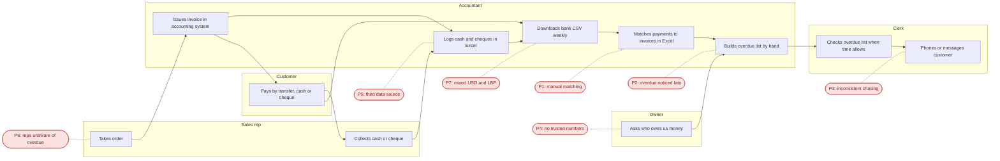

# Paidar — Discovery

> Atlas Trading is fictional and all data are synthetic. This document describes a scenario: its findings are hypotheses and assumptions, not measurements from a real company.

## 1. As-is process

How Atlas Trading handles receivables today.

### Pain points

| ID | Where | What goes wrong | Who is affected | Root cause |
|---|---|---|---|---|
| P1 | Matching payments to invoices | Manual and slow; references are inconsistent | Accountant | RC-1, RC-4 |
| P2 | Finding overdue invoices | The list is built by hand from two sources, so overdue items are noticed late | Clerk, owner | RC-1 |
| P3 | Chasing customers | No written rule for when, who or how, so some customers are chased late and others repeatedly | Clerk, customers | RC-2 |
| P4 | Reporting to the owner | Aging and DSO are not defined or calculated consistently, so the numbers are not trusted | Owner | RC-3 |
| P5 | Cash and cheque handling | A third data source, entered late and by hand, raises the error risk | Accountant | RC-1 |
| P6 | Sales visits | Reps do not see overdue balances before visiting or selling on credit | Sales reps | RC-5 |
| P7 | Payments in USD and LBP | Conversion, rounding and partial-payment differences complicate matching | Accountant | RC-1, RC-4 |

---

## 2. Root causes

### Five Whys

**P1: matching is slow and error-prone**

- Why? Payment references do not identify the invoice reliably.
- Why? Customers pay without an invoice number, bank narrations are free text, and cash has no reference.
- Why? Invoices do not carry a standard payment reference for the customer to quote.
- Why? Payment instructions were never standardised.
- **Root cause:** no standard payment reference on invoices, and three disconnected sources (RC-1, RC-4).

**P2: overdue invoices are noticed late**

- Why? Nobody reviews the overdue list daily.
- Why? The list must be built by hand from invoice and payment files.
- Why? Invoices and payments sit in different files and are matched only weekly.
- Why? Matching is manual (P1), so the list is only as fresh as the last match.
- **Root cause:** manual weekly matching feeding a manually built list (RC-1).

### Status of the charter's hypotheses

These cannot be confirmed without real data. They are accepted as working hypotheses that drive the requirements and the synthetic-data generator.

| ID | Hypothesis | Status | Note |
|---|---|---|---|
| RC-1 | Invoices, bank statements and the cash/cheque log are disconnected, so every match is manual | Accepted | Explains P1, P2, P5, P7 |
| RC-2 | No written rule for who is chased, when, by whom and how | Accepted | Becomes the reminder-ladder rules in Milestone 2 |
| RC-3 | Aging and DSO are not defined or calculated consistently | Accepted | Addressed by `docs/kpi_definitions.md` |
| RC-4 | References are missing or malformed in bank narrations and cash entries | Revised | Also, invoices carry no standard reference (see P1) |
| RC-5 | Sales reps have no routine view of their customers' overdue balances | Accepted | Becomes a per-rep overdue view in the dashboard |

---

## 3. Baseline

Every number below is an **assumption** used for a simulation. None is a measurement. Results will be reported as low, base and high.

| ID | Assumption | Low | Base | High |
|---|---|---|---|---|
| A-01 | Minutes to match one payment by hand | 3 | 4 | 5 |
| A-02 | Minutes per customer contact when chasing | 3 | 5 | 8 |
| A-03 | Share of invoices paid more than 30 days late | 10% | 12.5% | 15% |
| A-04 | Share of bank narrations with a missing or malformed reference | 20% | 25% | 30% |
| A-09 | Payments received per month | 120 | 150 | 180 |
| A-10 | Contacts per overdue invoice | 1 | 2 | 3 |

Invoices per month: about 170 (from the charter's company profile).

**Matching time** = payments per month × minutes per payment ÷ 60

| Case | Calculation | Hours per month |
|---|---|---|
| Low | 120 × 3 ÷ 60 | 6.0 |
| Base | 150 × 4 ÷ 60 | 10.0 |
| High | 180 × 5 ÷ 60 | 15.0 |

**Chasing time** = invoices per month × A-03 × contacts × minutes per contact ÷ 60

| Case | Calculation | Hours per month |
|---|---|---|
| Low | 170 × 10% = 17 invoices; 17 × 1 × 3 = 51 min | 0.85 |
| Base | 170 × 12.5% = 21.25 invoices; 21.25 × 2 × 5 = 212.5 min | 3.54 |
| High | 170 × 15% = 25.5 invoices; 25.5 × 3 × 8 = 612 min | 10.2 |

**Total manual effort (simulated):** about 6.9 / 13.5 / 25.2 hours per month (low / base / high).

Objective BO-1 targets reconciliation effort. A 70% reduction in matching time would leave 1.8 / 3.0 / 4.5 hours per month. The chasing figure is used in Milestone 9 to compare manual and automated reminders.

---

## 4. Competitor snapshot

Compiled from public vendor pages and directory listings, at a high level. It is not a feature-by-feature evaluation.

| Product | Official site | What it does | Aimed at |
|---|---|---|---|
| Chaser | https://www.chaserhq.com/ | Credit control and receivables automation: scheduled reminders, tracking of overdue accounts and credit-risk checks, connected to accounting systems | Small and mid-sized finance teams |
| Growfin | https://www.growfin.ai | AI-powered collections workflow, cash application and receivables reporting (aging, DSO), with ERP integrations such as NetSuite | B2B finance teams, mid-market and up |
| Payt | https://paytsoftware.com/ | Automated follow-up at set times, credit checks, payment options, payment plans, reconciliation and reporting; some AI features such as payment prediction | Organisations of many sizes, with ERP integrations |
| Fazeshift | https://fazeshift.com | AI agents for invoicing, cash application and collections, layered on top of existing ERPs | Enterprise finance teams |
| CashOnTime | https://www.cashontime.com/en | Invoice-to-cash platform from DIMO Software (France): automated collections, payment matching, risk scoring and consolidated dashboards | Finance departments with high volumes and several sites or ERPs |

**Patterns**

- All five combine payment matching or tracking, scheduled reminders and visibility.
- Most position themselves around AI, and most target teams that already run an ERP.
- In the summaries I reviewed, I did not see anything aimed specifically at a small business that settles USD invoices partly in LBP.

**Differentiation**

Unlike commercial receivables platforms that sell AI-driven automation to finance teams with an ERP, Paidar is a small, rule-based and fully auditable pipeline that runs locally for $0 on files a small business already has: invoice, bank and cash exports. It reconciles payments, reports aging and DSO, and sends rule-based reminders, and every decision can be traced to a tested rule.

---

## 5. Open questions from the charter

| ID | Question | Answer |
|---|---|---|
| Q-01 | Which exchange rate applies to which transaction? | **Decided for the project.** Invoices stay in USD. A configurable reference rate (default 89,500 LBP/USD) converts LBP payments at the rate on the payment date. Small rounding differences are tolerated; the tolerance is defined in Milestone 2. Real-world practice is unverified. |
| Q-02 | Are the credit terms and aging buckets typical for Lebanese distributors? | **Still open.** There is no real data. Net 15/30/45 and the standard buckets are scenario parameters, configurable in the generator. |
| Q-03 | How common are cheques and cash compared with bank transfers? | **Still open.** The scenario assumes about 60% bank transfer, 25% cash and 15% cheque as a generator parameter. |

---

## 6. What Milestone 2 takes from this

- Ingest and validate three sources: invoices, bank statements and the cash/cheque log.
- Matching rules: exact reference, then customer plus amount, then manual review. Handle partial, multi-invoice and over-payments.
- KPIs exactly as defined in `docs/kpi_definitions.md`.
- A written reminder ladder: who is chased, when, how, and what escalates.
- Multi-currency handling with a configurable rate and a rounding tolerance.
- An audit trail: every match and every reminder is logged.