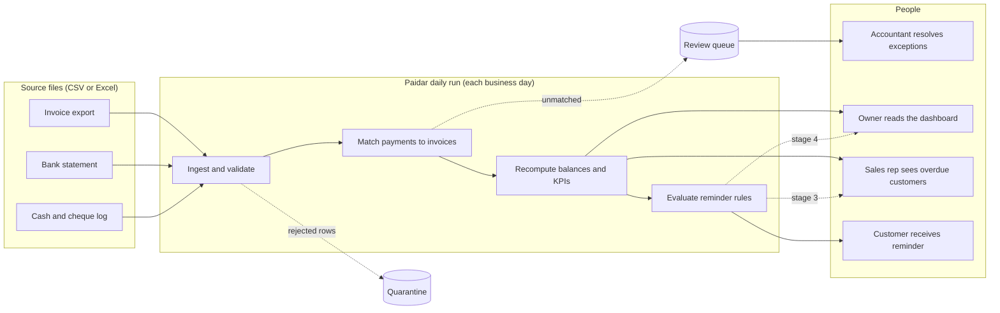

# Paidar — Requirements

This document turns the pain points in `docs/discovery.md` into requirements. Exact rules and thresholds live in `docs/business_rules.md`, and the KPI formulas in `docs/kpi_definitions.md`. The user stories with acceptance criteria are in `docs/user_stories.md`.

Priorities use MoSCoW: **Must**, **Should**, **Could**. Phase 1 is the core build (weeks 1–5), Phase 2 the advanced build (weeks 6–8), and Phase 3 the polish.

## 1. Gap analysis

| Pain point | As-is | To-be | Requirements |
|---|---|---|---|
| P1: manual matching | The accountant matches payments to invoices by hand in Excel | Payments are matched by rules; only exceptions reach a person | FR-05 to FR-13 |
| P2: overdue noticed late | The overdue list is built by hand, weekly at best | A worklist is refreshed by every daily run | FR-15, FR-19 |
| P3: inconsistent chasing | No written rule; depends on the clerk's time | A fixed reminder ladder, applied automatically and logged | FR-20 to FR-26 |
| P4: no trusted numbers | Aging and DSO are not defined or consistent | Nine KPIs defined once and calculated in SQL | FR-14, FR-17 |
| P5: third data source | Cash and cheques are logged by hand, late | The cash log is loaded and validated like the other sources | FR-01, FR-02 |
| P6: reps unaware of overdue | Reps do not see overdue balances | A per-rep view, plus escalation notices | FR-18, FR-24 |
| P7: mixed USD and LBP | Conversion and rounding are handled ad hoc | A configured rate and a rounding tolerance | FR-09 |

## 2. To-be process

## 3. Functional requirements

| ID | Requirement | Priority | Phase | Traces to |
|---|---|---|---|---|
| FR-01 | Load invoice exports, bank statements and the cash/cheque log from CSV or Excel into raw tables, recording the source file and load time. | Must | 1 | P5, RC-1 |
| FR-02 | Validate every row against the validation rules (BR-V1 to BR-V7). Send invalid rows to a quarantine table with a reason code and continue the run. | Must | 1 | P1, P5 |
| FR-03 | Ignore exact duplicate rows and quarantine conflicting duplicates, so reloading a file is safe (BR-V5, BR-M6). | Must | 1 | SC-3 |
| FR-04 | Produce a data-quality summary for each load: rows loaded, and rows rejected by reason. | Should | 1 | SC-3 |
| FR-05 | Match payments that carry a valid invoice reference, including full payments within the tolerance (BR-M1). | Must | 1 | P1, BO-1 |
| FR-06 | Handle partial payments and overpayments (BR-M2, BR-M3). | Must | 1 | P1 |
| FR-07 | Split one payment across several referenced invoices when the amounts agree (BR-M4). | Should | 2 | P1 |
| FR-08 | Match by customer and amount when exactly one open invoice qualifies (BR-M5). | Must | 1 | P1, BO-1 |
| FR-09 | Convert LBP payments to USD at the configured rate and apply the rounding tolerance (BR-C1 to BR-C4). | Must | 1 | P7 |
| FR-10 | Put every unmatched or ambiguous payment in a review queue with a reason code (BR-M7). | Must | 1 | P1, Q4 |
| FR-11 | Suggest matches for references with typos using fuzzy matching, never applying one automatically below the configured threshold (BR-M8). | Should | 2 | SC-2 |
| FR-12 | Record every match decision with the rule, confidence, timestamp and actor (system or person). | Must | 1 | NFR-05 |
| FR-13 | Let a reviewer record a decision on a queue item by script: approve, reject or assign to an invoice. | Could | 2 | P1 |
| FR-14 | Calculate the nine KPIs exactly as defined in `docs/kpi_definitions.md`. | Must | 1 | P4, BO-2 |
| FR-15 | Provide aging by customer and bucket, and an overdue worklist sorted by days past due and amount. | Must | 1 | P2 |
| FR-16 | Classify customers into risk segments (BR-S1, BR-S2). | Should | 1 | P2 |
| FR-17 | Provide a dashboard that answers the owner's five questions in three clicks or fewer. | Must | 1 | P4, SC-6 |
| FR-18 | Provide a per-sales-rep view of overdue balances. | Should | 1 | P6, RC-5 |
| FR-19 | Run the full pipeline (load, validate, match, recompute KPIs, evaluate reminders) automatically each business day (BR-R1, BR-R2). | Must | 1 | P2, BO-2 |
| FR-20 | Send the customer-facing reminder stages (stages 1 and 2) according to the reminder rules, delivered to a local inbox (BR-R2, BR-R4, BR-R6, BR-R7, BR-R9). | Must | 1 | P3, BO-3 |
| FR-21 | Never send the same reminder stage twice for an invoice (BR-R3). | Must | 1 | SC-5 |
| FR-22 | Log every reminder attempt (BR-R11). | Must | 1 | P3, Q5 |
| FR-23 | Combine same-day reminders for one customer into one message (BR-R5). | Should | 2 | P3 |
| FR-24 | Send stage 3 escalations to the sales rep and clerk, and stage 4 to the owner, creating follow-up tasks (BR-R10). | Should | 2 | P6 |
| FR-25 | Retry failed sends and escalate persistent failures (BR-R8). | Should | 2 | SC-5 |
| FR-26 | Run an error workflow that logs any workflow failure and notifies the owner's inbox. | Should | 2 | SC-5 |
| FR-27 | Generate synthetic data from a seed, with defects injected at configured rates. | Must | 1 | SC-3 |
| FR-28 | Provide a demo mode: one documented sequence of steps from a clean clone to a working dashboard. | Must | 3 | SC-1 |
| FR-29 | Provide a baseline-versus-automated impact simulation with low, base and high cases. | Should | 2 | BO-1, BO-4, SC-7 |

**Summary:** 29 requirements: 18 Must, 10 Should and 1 Could. In Phase 1, the review queue is a list of payments with reason codes that the dashboard shows. Phase 2 adds fuzzy suggestions and the reviewer script.

## 4. Non-functional requirements

| ID | Requirement | Measure | Source |
|---|---|---|---|
| NFR-01 | Cost: the project uses only free tools and requires no payment details. | Every tool in `docs/COST_LOG.md` shows "Payment details: No" | SC-10 |
| NFR-02 | Reproducibility: anyone can reach a working demo from a clean clone. | 15 minutes or less, no paid accounts | SC-1 |
| NFR-03 | Performance: a full pipeline run on the demo dataset is quick. | 5 minutes or less on the development machine | BO-2 |
| NFR-04 | Safe re-runs: running any step twice creates no duplicate data, matches or reminders. | Verified by automated tests | SC-5 |
| NFR-05 | Auditability: every match, rejection and reminder can be traced to a rule and its inputs. | Every decision has a stored rule ID | FR-12, FR-22 |
| NFR-06 | Testability: business rules are covered by automated tests. | At least one test per rule; coverage of at least 80% on matching and rules modules | SC-4 |
| NFR-07 | Configurability: thresholds, delays, schedules and rates are configuration, not code. | Changing a value in `business_rules.md` section 1 needs no code change | NFR-02 |
| NFR-08 | Privacy and security: synthetic data only; secrets stay in environment variables and never in the repository. | No secrets in the git history | Charter |
| NFR-09 | Observability: each pipeline step writes a log entry, and failures are visible. | Failures appear in the log and, in Phase 2, in the error workflow | FR-26 |
| NFR-10 | Portability: developed and tested on Windows 11 with PostgreSQL 17. Other platforms are untested. | Stated in the README | Charter |

## 5. Out of scope for this release

- An interactive review or approval interface. The queue is visible on the dashboard, and decisions are recorded by script (FR-13, Could).
- Real email, SMS or WhatsApp delivery.
- Machine-learning payment prediction.
- Reminders before the due date.
- Dispute management and payment plans.
- Public-holiday calendars. Business days are Monday to Friday.
- Connectors to accounting software or bank APIs.
- Logins, roles and permissions.
- Tax, legal or collection-agency handover.
